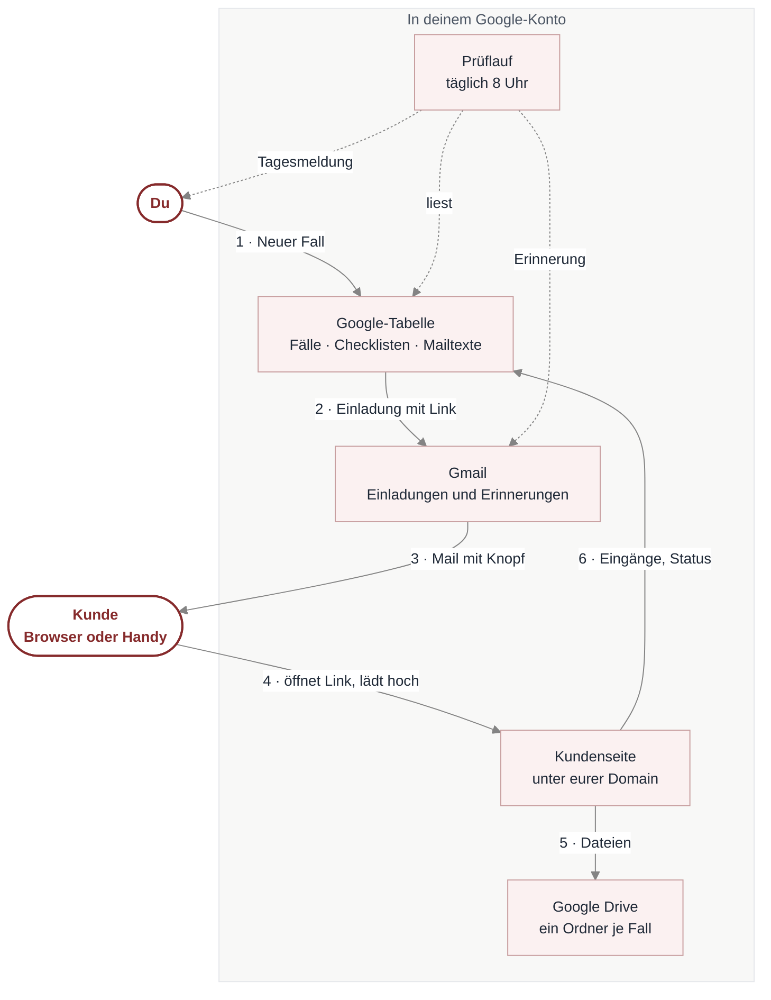
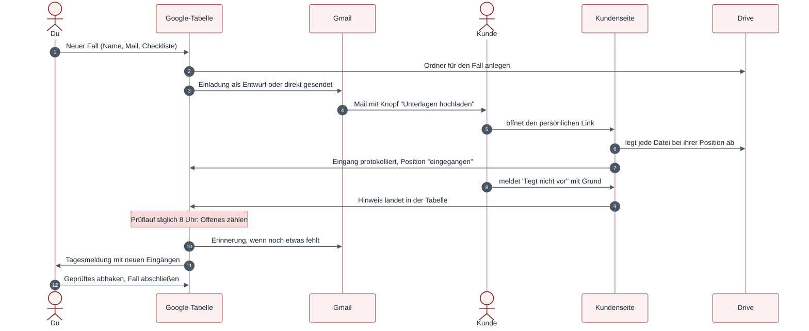
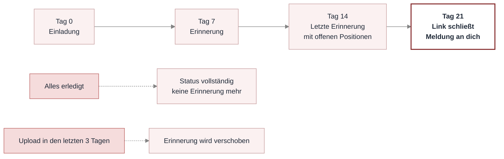
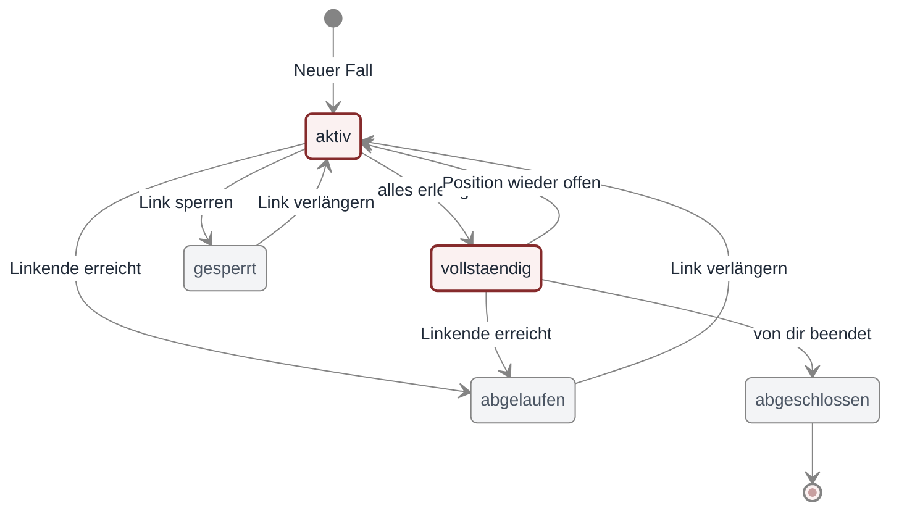
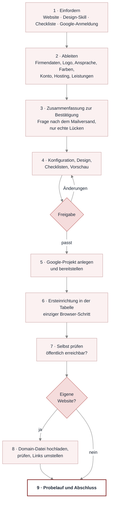
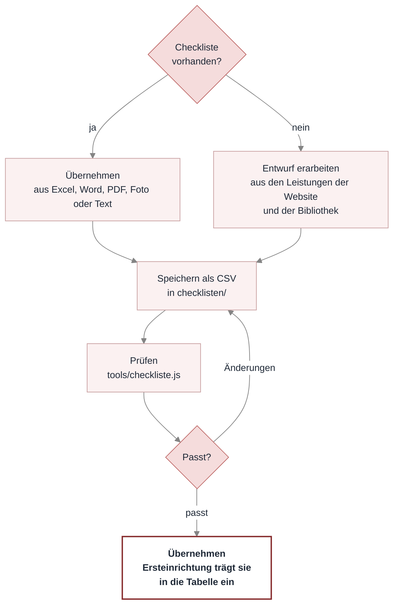

# Upload-Strecke

Kunden laden ihre Unterlagen über einen persönlichen Link hoch, Position für Position nach
einer Checkliste. Für jede Branche: Energieberatung, Finanzierung, Steuerberatung, Hausverwaltung
oder alles andere, wo Unterlagen von Kunden kommen. Du siehst in einer Google-Tabelle, was da
ist und was fehlt. Einladungen und Erinnerungen entstehen automatisch als Gmail-Entwurf oder gehen
direkt raus.

Alles läuft im eigenen Google Workspace. Keine Server, keine Datenbank, keine monatlichen Kosten.

Wie alles zusammenspielt, zeigen die Schaubilder unter [So funktioniert es](#so-funktioniert-es).

## Was drin ist

- **Kundenseite** mit Checkliste, Upload je Position, Foto direkt vom Handy, Meldung "liegt nicht
  vor" mit Grund, Fortschrittsanzeige. Du- oder Sie-Ansprache, eigenes Design und Logo.
- **Google-Tabelle als Fallverwaltung** mit Menü: Neuer Fall, Einladung, Link verlängern, Link
  sperren, Erinnerungen prüfen, Selbsttest.
- **Checklisten für jede Branche:** Claude übernimmt eure vorhandene Liste oder erarbeitet aus
  euren Leistungen einen Entwurf (`/checkliste`). Bibliothek mit Beispielen für Energieberatung,
  Finanzierung und Allgemein in `vorlagen/checklisten/`. Mehrfach-Blöcke für Objekte, Maßnahmen
  oder Personen.
- **Gestaltete HTML-Mails** für Einladung, Erinnerung 1 und letzte Erinnerung, im Design der
  Kundenseite mit Knopf zum Upload, je in Du und Sie, Texte in der Tabelle änderbar.
- **Täglicher Prüflauf**: zählt Offenes, schickt Erinnerungen an Tag 7 und 14, meldet dir Tag 21,
  Tagesmeldung mit neuen Eingängen.
- **Eigene Domain** (optional): `https://www.deine-firma.de/unterlagen/?t=…` statt Google-Adresse.
- **Sicherheit**: Link mit zufälligem Schlüssel (rund 150 Bit), nur PDF und Bilder (Prüfung der
  Dateisignatur), keine Lese- oder Löschfunktion für Kunden, Verwaltungsfunktionen nur aus der Tabelle aufrufbar,
  Kundentexte können keine Tabellenformeln auslösen, Grenzen je Datei und je Fall, Sperre wirkt sofort.

## So funktioniert es

### 1 · Überblick: wer, was, wo

Alles bleibt in deinem Google-Konto. Der Kunde braucht kein Konto, nur seinen Link.



### 2 · Ein Fall von Anfang bis Ende



### 3 · Zeitplan der Erinnerungen



Fristen, Pause und Linklaufzeit stehen im Blatt **Einstellungen** und lassen sich ändern.

### 4 · Status eines Falls



Hochladen geht nur bei **aktiv** und **vollständig**. Eine Sperre wirkt sofort, auch für ein
offenes Browserfenster.

### 5 · Einrichtung mit Claude

Claude fragt nur, was es nicht selbst herausfinden kann. In der Regel bleibt eine Frage: wie Mails
rausgehen sollen.



### 6 · Checklisten für jede Branche



Je Leistung eine Vorlage, z. B. Sanierungsfahrplan, Förderung Einzelmaßnahme und Energieausweis.
Was mehrfach vorkommt (Objekte, Maßnahmen, Personen), legt der Kunde als eigene Blöcke an.
Neue Checklisten jederzeit mit `/checkliste`.

## Schnellstart mit Claude Code

1. Repo klonen und den Ordner in Claude Code öffnen.
2. Claude erkennt, dass noch nichts eingerichtet ist, und startet die Einrichtung. Alternativ
   `/einrichten` eingeben.
3. Claude fordert vier Dinge ein: eure Website-Adresse, euren Design-Skill oder Styleguide, eure
   bisherige Unterlagen-Checkliste (falls vorhanden) und die Google-Anmeldung. Firmendaten, Logo,
   Ansprache, Farben, Konto und Hosting liest es daraus selbst. Gefragt wird danach nur, was fehlt, und wie Mails rausgehen sollen.
4. Zwei, drei Klicks im Browser (Google-Anmeldung, Berechtigungen). Claude sagt jeweils, wo.
5. Am Ende stehen eine Tabelle mit Musterfall "Max Mustermann", ein funktionierender Link und ein
   Testupload im Drive.

Dauer: rund 30 Minuten, mit eigener Domain etwas mehr.

## Ohne Claude

Die Schritte stehen einzeln in `docs/`:

| Datei | Inhalt |
|---|---|
| [docs/01-einrichtung-google.md](docs/01-einrichtung-google.md) | Google-Konto, clasp, Tabelle, Bereitstellung |
| [docs/02-domain.md](docs/02-domain.md) | Kundenlinks unter der eigenen Domain (Datei per `node tools/domaindatei.js`) |
| [docs/03-faelle-und-schluessel.md](docs/03-faelle-und-schluessel.md) | Fälle, Links, Schlüssel, Status, Ablage |
| [docs/04-checklisten.md](docs/04-checklisten.md) | Checklisten-Vorlagen anlegen und pflegen |
| [docs/05-mails-und-erinnerungen.md](docs/05-mails-und-erinnerungen.md) | Mailmodus, Platzhalter, Zeitplan |
| [docs/06-design.md](docs/06-design.md) | Farben, Schrift, Logo, Vorschau |
| [docs/07-fehlerbilder.md](docs/07-fehlerbilder.md) | Typische Fehler und Lösungen |
| [docs/08-datenschutz.md](docs/08-datenschutz.md) | Was datenschutzrechtlich zu klären ist |

## Lokal prüfen, ohne Google-Konto

```bash
node tools/vorschau.js
```

```bash
node tools/mailvorschau.js
```

```bash
node tools/test-lokal.js
```

Die Vorschauen schreiben `ausgabe/vorschau.html` (Kundenseite mit Musterfall, Uploads simuliert)
und `ausgabe/mail-*.html` (die drei Kundenmails).
Der Testlauf spielt Ersteinrichtung, Uploads, Meldungen, Einladung, Erinnerungen und Sperre gegen
nachgebildete Google-Dienste durch.

## Was nie ins Repo gehört

`apps-script/Konfig.gs`, `.clasp.json`, `einrichtung.local.md` und `ausgabe/` stehen in
`.gitignore`. Dort liegen Web-App-Adresse, Script-ID, Firmendaten und Testausgaben. Kundendaten
liegen ausschließlich in der Google-Tabelle und im Drive.
